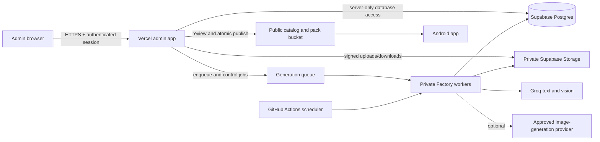

# StickerDock Admin Control Plane — product and architecture plan

Status: planning only. This document describes a separate private web application;
it does not claim that these admin features are currently deployed.

Implementation update, October 14: the first owner admin MVP is now in `admin/`
with Vercel Python APIs, reusing the current stack rather than starting a Next.js
migration. See [ADMIN_PORTAL.md](ADMIN_PORTAL.md) for implemented scope and the
remaining deployment/Auth/roles work. The broader roadmap below remains the
long-term plan.

## 1. Current product truth

- The Android APK is the user-facing offline sticker library and WhatsApp pack
  provider. It must never contain Groq, Supabase service-role, GitHub or other
  administrative credentials.
- The existing private Factory runs outside the APK through GitHub Actions,
  Python workers, Supabase tables and private Storage.
- Groq currently helps with captions, prompts and vision analysis. Pillow and the
  local render pipeline create the sticker pixels. Fully synthetic image creation
  will require a separately approved image-generation provider.
- Generated packs remain private and pending until an administrator reviews and
  publishes a GENERAL-rated pack. Mature packs stay private/offline.
- APK installation alone does not activate the Factory, Creator Studio, hosted
  admin site, release signing or production WhatsApp acceptance testing.

## 2. Goal

Build an independent, authenticated admin control plane that gives the owner one
place to manage sources, generation, stickers, packs, review, publication,
schedules, storage and operational health. Deploy it as its own Vercel project.
The Android app only consumes the approved public catalog and continues to work
offline for private local collections.

Recommended location: an `admin/` application in this repository, connected to a
separate Vercel project. This keeps migrations and shared schemas together while
preserving an independent build, URL, runtime and access policy from the APK.

## 3. Proposed architecture

### Web application

- Next.js with TypeScript, React, Tailwind and shadcn/ui.
- Server Components for read-heavy pages; Route Handlers or Server Actions for
  mutations. Validate every request and response with Zod.
- TanStack Table for filtering and bulk operations; React Hook Form for editors.
- Responsive desktop-first admin UI. Mobile supports monitoring and approvals;
  precise sticker composition remains optimized for desktop/tablet.
- Retain the current static Creator Studio during migration. Move its canvas
  editor into the new admin app only after feature parity is tested.

### Backend and workers

- Supabase Postgres is the source of truth for metadata, status and audit events.
- Supabase private Storage holds uploads, generation inputs, drafts and rejected
  assets. Public Storage contains only approved GENERAL pack ZIPs and catalogs.
- Vercel handles authenticated CRUD, signed URLs, validation and lightweight job
  orchestration. Long-running image/video work stays in Factory workers.
- Existing GitHub Actions workers can initially poll the queue. Later, move to a
  dedicated container worker if queue latency or execution limits become a problem.
- Use idempotency keys, leases, bounded retries and dead-letter states for every
  background job. Never render synchronously inside a Vercel request.

### Authentication and authorization

- Supabase Auth with owner-approved accounts, MFA and disabled public sign-up.
- Roles: `owner`, `admin`, `editor`, `reviewer`, `viewer`.
- Enforce permissions in Postgres/RLS and server APIs, not only in UI controls.
- Keep `SUPABASE_SERVICE_ROLE_KEY`, AI keys and GitHub credentials in Vercel or
  worker secrets. The browser receives only public configuration and short-lived
  signed URLs.
- Record every create, edit, approval, rejection, publish, unpublish, retry,
  cancellation and configuration change in an append-only audit log.

## 4. UI information architecture

### Dashboard

- Daily target, generated count, success rate, queue depth and failed jobs.
- Pending review, approved/published packs, storage usage and provider usage.
- Factory status with pause state, last heartbeat and last successful run.
- Alerts for stale jobs, expiring signed links, storage thresholds and invalid
  catalog entries.

### Factory control

- Pause/resume scheduled generation with a reason and audit entry.
- Request one bounded run, cancel queued jobs, retry failed jobs and recover stale
  leases. Running work should stop only at a safe checkpoint.
- Configure daily targets, batch sizes, allowed modes, rating, topic rotation,
  cooldowns, model selection and spending/request ceilings through versioned
  configuration revisions.
- Show run timeline, logs, duration, provider metrics, output counts and errors.
- Roll back to a previous configuration; never edit active configuration without
  creating a revision.

### Sources and media library

- Upload images or clips, add source URL, license/rights, attribution, rating and
  tags, and inspect exact-hash duplicates.
- Browse manual uploads, CC0/public-domain assets, authorized Pinterest items and
  reference-only inputs.
- Preview validation results: dimensions, duration, frames, file size, MIME type,
  hash and malware-scan state.
- Archive or restore sources. Destructive purge requires owner permission and a
  retention check showing which jobs and stickers reference the asset.

### AI generation workbench

- Create a generation job from a source, topic, caption idea or approved template.
- Control language, tone, audience, pack category, static/animated mode, caption
  style, prompt variables and number of candidates.
- Preview the final expanded prompt and estimated request count before enqueueing.
- Compare candidates side by side, rate quality, regenerate selected items and
  promote a candidate into the sticker editor.
- Maintain prompt templates with versions, test cases, quality notes and rollback.
- Add provider adapters behind one interface. Provider keys remain external
  secrets; the UI shows connection status and model availability, never key values.
- Capture reviewer feedback as structured labels so future prompt/template changes
  can be measured instead of relying on subjective notes alone.

### Sticker editor

- Canvas preview with caption, font, size, position, width, fill, outline, crop,
  background removal, uppercase, safe-area and transparent-background controls.
- Edit filename, display label, tags, category, rating, attribution and alt text.
- Validate WhatsApp rules before save: 512×512, static/animated separation, size,
  frame duration/count and maximum duration.
- Save immutable revisions, compare versions, restore an older revision, download
  a draft and add the chosen revision to a pack.

### Packs

- Create, view, rename, duplicate, archive and restore packs.
- Add/remove/reorder stickers, bulk tag, move/copy between compatible packs and
  split packs that exceed WhatsApp's limit.
- Edit title, creator, category, rating, cover/tray image and release notes.
- Run pack validation, build a deterministic ZIP, compare checksums and download a
  private preview.
- Show pack lifecycle: `draft → pending_review → approved → published`, with
  `rejected`, `archived` and `unpublished` side states.

### Review and moderation

- Review queue with sticker-level zoom, source provenance, license, rating,
  generation prompt, duplicate matches and validation results.
- Approve/reject individual stickers or whole packs with required reasons.
- Separate content approval from publication. Require a second approval for risky
  sources or future community submissions.
- Future community module: identity, rights declaration, malware scan, report,
  block, appeal, age controls and moderation history. Keep community uploads
  disabled until all controls exist.

### Catalog and publishing

- Preview exactly what the Android public catalog will display.
- Publish only validated, approved, GENERAL packs in one atomic operation.
- Verify ZIP checksum and public catalog consistency after publication.
- Unpublish/delist without deleting the private source or audit history.
- Support staged environments: local, preview and production. Production actions
  display the destination and require an explicit final confirmation.

### Operations and settings

- Queue explorer, failed-job details, worker heartbeat, storage browser, quota
  graphs, API/provider status and recent audit events.
- Manage users and roles, allowed models, limits, retention policies, catalog URL,
  schedule settings and notification destinations.
- Secret-status page shows only `configured`, `missing` or `invalid`; it never
  reads or displays secret values.

## 5. Data model additions

Preserve the existing `factory_runs`, `sticker_packs` and `creator_requests`
tables. Add migrations rather than rewriting or dropping production data.

| Table | Purpose |
| --- | --- |
| `admin_profiles`, `admin_roles` | Approved users and role membership |
| `source_assets` | Upload path, hash, rights, attribution, scan and archive state |
| `prompt_templates`, `prompt_template_versions` | Versioned generation instructions |
| `generation_jobs`, `generation_items` | Job lifecycle, inputs, attempts, metrics and candidates |
| `sticker_assets`, `sticker_revisions` | Canonical sticker metadata and immutable file revisions |
| `pack_items` | Ordered sticker membership in a pack |
| `review_decisions` | Reviewer, decision, reason and policy version |
| `publish_events` | Publish/delist history, catalog version and checksums |
| `factory_config_versions` | Versioned schedules, models, modes, budgets and pause state |
| `worker_heartbeats` | Worker identity, version, capabilities and health |
| `audit_events` | Append-only actor/action/entity/change metadata |

Use foreign keys, status constraints, unique hashes, optimistic version columns
and `created_at`/`updated_at` timestamps. Store files in Storage and only paths,
hashes and metadata in Postgres.

## 6. Server API boundaries

- `/api/dashboard` and `/api/health`: aggregated read models.
- `/api/sources`: upload session, metadata CRUD, archive and signed preview.
- `/api/generation-jobs`: enqueue, inspect, cancel and retry.
- `/api/stickers` and `/api/packs`: validated CRUD, revisions and ordering.
- `/api/reviews`: approve/reject with policy and provenance checks.
- `/api/publish`: preflight, publish, verify and unpublish.
- `/api/factory`: configuration revisions, pause/resume and bounded run requests.
- `/api/audit`: filtered, read-only event history.

All mutations require authentication, role checks, CSRF protection, schema
validation, rate limits and an audit event. Return operation IDs for long-running
work and stream/poll status instead of keeping requests open.

## 7. Infrastructure

- **Vercel:** separate admin project, preview deployments, protected production
  environment, server functions and CSP/security headers.
- **Supabase:** Auth, Postgres, RLS, private/public Storage, migrations and database
  backups. Use separate local/preview/production projects or schemas.
- **Workers:** current GitHub Actions schedules first; dedicated container worker
  later if execution time, concurrency or observability requires it.
- **Observability:** structured logs with operation IDs, error tracking, worker
  heartbeats, queue age, failure rate, provider usage and storage quota alerts.
- **CI:** TypeScript checks, unit tests, API authorization tests, migration tests,
  Playwright admin flows, Python Factory tests and catalog/pack validation.
- **Recovery:** daily database backups, versioned/immutable production artifacts,
  tested restore procedure and documented rollback for migrations and publishing.

## 8. Build order

1. Foundation: Next.js shell, Supabase Auth, roles, navigation, audit log and
   environment separation.
2. Read-only operations: dashboard, existing Factory runs, requests, packs,
   private assets, logs and storage health.
3. Core CRUD: sources, stickers, revisions, pack membership, metadata and archive.
4. Generation workbench: templates, jobs, queue controls, candidates and feedback.
5. Review/publishing: approval policy, deterministic pack build, catalog preview,
   atomic publish/unpublish and post-publish verification.
6. Factory controls: versioned configuration, pause/resume, bounded manual runs,
   retries and worker health.
7. Creator Studio migration: move the existing canvas editor into the admin app
   after parity tests, then retire the old private page.
8. Production hardening: MFA, authorization matrix tests, alerts, backups,
   Playwright smoke, Vercel deployment and an operator runbook.

## 9. Definition of done

- No privileged credential appears in browser code, logs, APKs or Git.
- Every entity supports the intended CRUD/archive behavior with role checks.
- Every generation is traceable to source, prompt/template version, model,
  configuration, output hash and reviewer decision.
- Failed/retried jobs are idempotent and cannot create duplicate published packs.
- Only approved GENERAL content reaches public Storage and the Android catalog.
- Publish/unpublish has automated preflight, audit evidence and rollback.
- Preview and production environments are isolated and clearly labeled.
- CI passes and a hosted authenticated browser smoke proves the complete flow:
  upload → generate → edit → pack → review → publish → Android catalog read.
