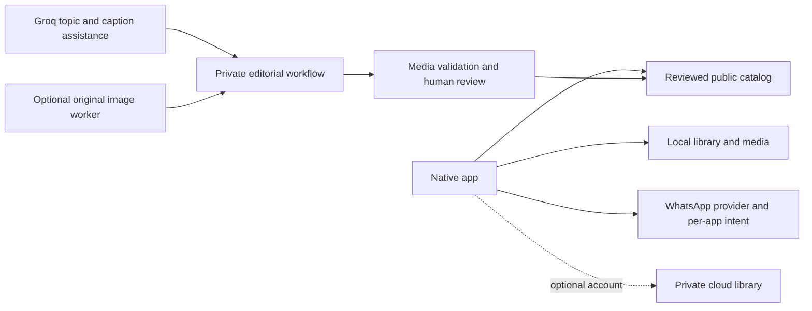

# StickerDock product rebuild

Decision date: October 18, 2026. [The user's full request](PRODUCT_REBUILD_REQUEST_2026-10-18.md)
is the scope authority. This is a product redesign, not a checklist of the few
symptoms mentioned in chat. Status below distinguishes implemented source from
verified behavior and future work. It supersedes the presentation priorities in
the October 15 recovery plan; previous data/format guarantees still apply.

## Product promise

Find or make a pack you actually want to send, keep it, and use it in WhatsApp.
The pack is the main browsing and ownership unit. Individual stickers appear
inside packs, in the editor and in contextual search previews. Maintenance tools
must not compete with the artwork.

Initial audience: people who use reaction stickers frequently, want their own
photos/clips, and need a durable personal collection. The initial catalog should
come from reviewed original/editorial packs, not depend on a social network
having enough creators. Public creator profiles, follower counts and social
feeds do not solve that first-use problem.

## Primary-source comparison

Inspected public product pages/documentation on October 18. This is not a claim
to have reverse-engineered private apps or tested every current native screen.

| Reference | Useful product pattern | StickerDock decision |
| --- | --- | --- |
| [Sticker.ly](https://sticker.ly/) and [creation FAQs](https://sticker.ly/faq/en/) | Pack discovery and photo/animated creation leading into WhatsApp | Familiar pack → preview → save/add journey; independent brand and artwork |
| [Sticker Maker](https://stickermaker.app/) | Search and reaction/topic categories | Search belongs above pack artwork; avoid a huge taxonomy before content exists |
| [Telegram editor](https://telegram.org/blog/sticker-maker) | Photo editing, automatic cutout/manual correction, adding to sets, emoji discovery | Explicit pack destination, reversible edits, eventual automatic cutout and semantic reaction tags |
| [Signal stickers](https://signal.org/blog/make-privacy-stick/) | Private pack ownership and simple set sharing | Local collection works without login; cloud backup and publication are separate choices |
| [Official WhatsApp Android sample](https://github.com/WhatsApp/stickers/tree/main/Android) | Per-pack installation, type separation, provider/version contract | One clear pack action; select consumer/Business only when needed; never pretend to send directly into a chat |

The LINE creator page could not be fetched reliably in this session; it is not
used as evidence. Do not invent an exhaustive feature-parity claim from this
research. Sticker.ly media is a visual reference, not a reusable catalog.

## Repository and model evaluation

| Source | Finding / use |
| --- | --- |
| [WhatsApp/stickers](https://github.com/WhatsApp/stickers) | Primary integration contract. Retain our independently implemented provider and contract tests. |
| [StickerVault](https://github.com/mintnchocochip/stickervault) | Useful migration/portable-library reference. GPL implementation is not copied into MIT source. |
| [PhotoEditor](https://github.com/burhanrashid52/PhotoEditor) | Established editing primitives/undo; adopting another view-based editor would duplicate current Compose recipes. Keep the recipe engine and improve its controls. |
| [rembg](https://github.com/danielgatis/rembg) | Candidate server cutout stage. Evaluate actual model weights, license, edge quality and runtime before adding dependencies. No package/model installed in this pass. |
| [ML Kit subject segmentation](https://developers.google.com/ml-kit/vision/subject-segmentation/android) | Optional native cutout implemented with beta 16.0.0-beta1. On-device processing, first-use Play services model download, cancellable UI and manual fallback. Live inference/quality still requires device acceptance. |
| [FLUX.2 klein 4B](https://huggingface.co/black-forest-labs/FLUX.2-klein-4B) | Apache-2.0 weights; documented standard memory footprint is approximately 13 GB. Local GTX 1650 has 4 GB. CPU offload/quantization is an experiment, not a free production capacity promise. |
| [BFL asynchronous generation](https://docs.bfl.ai/quick_start/generating_images) | Optional server image adapter with persisted request IDs and bounded polling. Paid calls remain disabled by default. |
| [Groq vision](https://console.groq.com/docs/vision) | Retain existing image understanding/caption roles. Do not represent a text/vision response as newly synthesized artwork. |

The earlier eight-repository investigation remains in
[REAL_MEDIA_CREATOR_PLAN_2026-10-16.md](REAL_MEDIA_CREATOR_PLAN_2026-10-16.md).
No third-party implementation or sticker art was copied in this rebuild.

## Keep, move, remove, add

| Area | Decision | Candidate status |
| --- | --- | --- |
| Library | Named pack rows with four large artwork previews, metadata below the title | Implemented |
| Search | Search labels/tags but show matching packs; respect type/category filters for all matches | Implemented |
| Discover | Artwork-led pack cards; creator/count; one view/open action | Implemented |
| Reporting/hiding | Contextual overflow actions; remain available | Implemented |
| Static/animated | Direct type chips; never mix a WhatsApp pack | Implemented |
| Creation | Two clear entries: photos and video/GIF | Implemented |
| Photos | Pick → name/select pack → explicit save → edit | Implemented; failed inputs stay available for retry |
| Duplicate photos | Explicit creation can reuse a photo in another pack; duplicates inside a selection/target do not multiply | Implemented; migration still deduplicates globally |
| WhatsApp | Direct action for one installed target; chooser for two; recovery add-again action | Implemented; physical acceptance pending |
| Account/cloud | Secondary settings; no login to use local packs | Implemented |
| ZIP/backups | Import/backup utility, not the main sharing language | Main pack action renamed Share pack; archive interchange retained |
| Pack sharing links | Public reviewed pack link/deep link; private capability link with revocation/expiry | Planned; this candidate still shares a portable file |
| Legacy launcher | Remove inactive duplicate activity with its second UI implementation | Removed; manifest launcher and data identities unchanged |
| AI-generated catalog | Coherent character/theme packs with distinct useful reactions; private review first | Optional original-art worker prepared, not enabled/live-validated |
| Automatic cutout | One-tap subject extraction, restore/erase correction, reversible source | Implemented: confidence masks retained separately, erase/restore brush, undo/redo and drafts. Automatic model quality and signed brush acceptance remain separate gates; see QA_MATRIX.md. |
| Favorites/recents | Small personal shortcuts, backed by an additive migration | Planned after core acceptance |
| Community | Defer social/feed mechanics until catalog and moderation are dependable | Existing reviewed catalog retained; no unreviewed upload feed |

## Navigation and screen contract

Three destinations: **Library · Create · Discover**. Keep Library as launch
destination while the public catalog is small, so offline/personal users never
land on an empty online feed. Reconsider discovery-first only after the catalog
quality gate passes.

- Library: search, All/Static/Animated, compact count/new-pack action, pack rows.
  Empty state offers photos/import. Draft recovery appears only when needed.
- Pack detail: pack name, count/type, artwork grid, contextual management, sticky
  WhatsApp action. Fewer than three stickers leads to adding more, not a dead export.
- Create: clear source choices; no operator dashboards, provider names, disabled
  AI promotions or maintenance metrics in the main experience.
- Discover: browse without import side effects. An already saved pack opens from
  local storage, even if another download would fail. Never silently recreate a
  deliberately deleted saved pack.
- Settings: optional account/cloud, migration and backups. ZIP remains the
  interoperable implementation; users do not need to learn that format to browse.

Visual system: white/neutral surfaces, dark ink, restrained green for WhatsApp,
consistent line icons, 48dp touch targets, larger artwork, fewer nested cards.
Dark mode, 360dp/200% text and tablet layouts remain acceptance requirements.

## Architecture and infrastructure

Keep native Kotlin/Compose and the shared media core. SQLite v8, pack/sticker
identities, app-private media, ZIP v5, older restore readers, ContentProvider
authority and release certificate remain stable. A framework rewrite would not
fix insufficient content or a broken handoff and would put collections at risk.

The inactive legacy activity is removed. Reusable product components,
pack-presentation decisions and photo destination UI now have separate files.
The active activity still owns too much async state; a lifecycle-aware library
controller/repository extraction remains required. Do not claim MVVM conversion
or full Android/iOS parity in this candidate.

Retain current Supabase private/public separation, RLS and immutable published
assets. Vercel is the authenticated control plane, not a GPU renderer. Long image
jobs run in a worker with durable states. The CLI original worker is not yet
connected to Supabase/Admin/native jobs; its filesystem journal is a development
boundary, not a claim of deployed distributed infrastructure.

Do not add Kubernetes, another database, a payment service or mandatory accounts
before measuring a need. Keep existing scheduled Groq jobs/cooldowns intact.
Do not infer daily output quality/capacity from a successful scheduler exit.

## AI and content supply

Free/existing path: Groq research and captions + owned/licensed photos/clips +
local media processing. Paid/optional path: original image pixels from a separate
model. Keep their quality and cost measurements separate.

The new worker accepts one coherent brief: character, style, named pack and
3–30 distinct emotions/poses/captions. Each reaction is generated separately;
no brittle sprite-sheet splitting. It retains a private request journal, source
image, normalized WebP and metadata. Interrupted submissions stop for operator
attention instead of risking an automatic duplicate charge. Generated output
ends at **needs_review**, never automatic publication.

Character consistency is a shared prompt, not a guarantee; reference-image
conditioning is a future improvement. Captions are searchable metadata in this
first original-art path, not hallucinated text rendered inside images. Automatic
background extraction is still pending; the reviewer must reject/repair poor
edges or unwanted backgrounds. The existing Groq media path still supports
painted captions. New Factory exports preserve caption/reaction metadata in v5.

Use a fixed 12-reaction evaluation set (hello, yes, no, thanks, sorry, laughing,
surprise, tired, love, waiting, celebration, goodbye). Compare models for
character consistency, silhouette, usefulness, readable expression at chat size,
cutout quality and actual accepted cost. The BFL adapter is a candidate, not a
claim that its outputs beat Sticker.ly or OpenAI. Current pricing must be checked
at [BFL](https://bfl.ai/pricing) before enabling it. Request caps are not dollar
billing guarantees. No image provider key or credits were provisioned here.

## Delivery gates

The continued visual pass uses warm neutral surfaces, restrained green/lime
accents, consistent rounded cards and a deliberate type scale. Library packs
have distinct artwork cards. Create offers photo/video cards with one clear
action each. The editor groups Cutout, Transform and Text around a larger
checkerboard preview; draft status and original-preserving reset remain visible.
UI acceptance uses actual APK screenshots, including large text, rather than
only design mockups. Synthetic performance fixtures do not establish catalog
artwork quality.

Native public-pack codes/custom links now resolve through the reviewed catalog
before preview; saving stays explicit. Received pack files open an import
confirmation, and shared photos use the named destination sheet. Export filenames
use the pack title and separate files per share so a later export cannot replace
an earlier recipient's pending file. See PUBLIC_PACK_CODES.md for HTTPS/private
link gaps and QA_MATRIX.md for matching verification.

1. Native unit tests, backend regressions, lint, signed build, exact-APK emulator
   navigation/creation/preservation. Inspect actual screenshots, including a
   real-artwork fixture; flat-color performance fixtures are not visual sign-off.
2. Galaxy S24 Ultra: create/save/reopen, SAF 10k+ import/pause/process death,
   installed consumer and Business export, edit/refresh, add-again, cancel.
3. Content: review at least six coherent original/editorial packs spanning common
   conversational needs. Record rejection rate; no filler to meet a daily quota.
4. AI: live provider trial only after an approved spending limit/key exists;
   persistence, failure recovery, background quality and account isolation.
5. Share links/native assistant/editor cutout and iOS parity each need their own
   implemented flow and matching evidence before being called complete.

This candidate is a substantial first rebuild slice. It is not a complete
Sticker.ly replica, a production-certified WhatsApp integration, or a live
original-image generation service.
